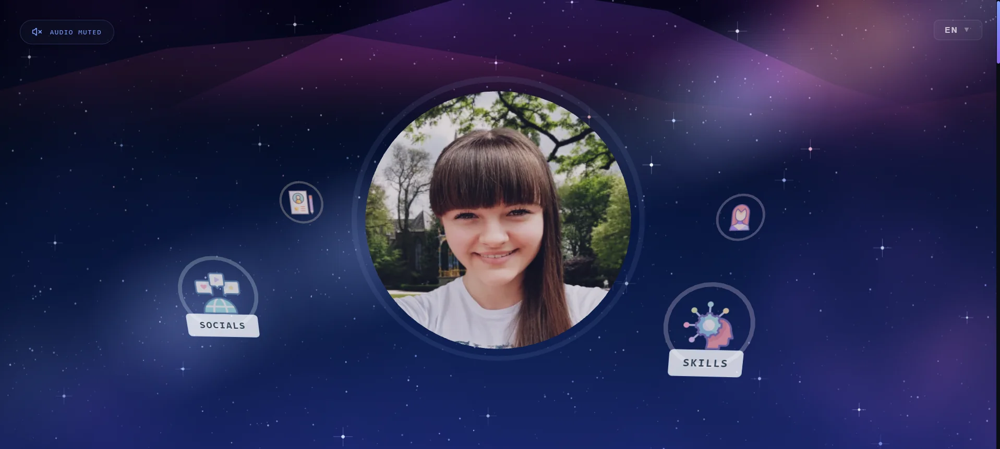

# Victoria's Interactive Cosmos

The portfolio of Victoria Ghoos, software engineer: an interactive 3D night sky built with React and Three.js.

**Live:** [victoriaghoos.com](https://victoriaghoos.com/)



## What it is

- **3D hub (desktop):** a React Three Fiber scene with a hologram portrait, orbiting panels with video previews, drag-to-rotate with inertia and constellations that appear on hover.
- **Procedural night sky:** Canvas 2D with a Perlin-noise nebula, parallax star layers, a galactic band, bloom, click shockwaves and shooting stars that fan out from a radiant.
- **Sections:** about, skills, projects, a flipbook resume, notes and a socials section with WebGL clouds.
- **Four languages:** English, Dutch, French and Japanese (i18next).

## Engineering decisions

**Performance.** Mobile Lighthouse score 93 (LCP 2.5 s, TBT 210 ms, CLS 0).

- Phones and tablets never download three.js: they get the hologram as a preloaded image, a 2D menu and a lighter night sky where the faint stars are painted once into a cached backdrop.
- Shaders compile in the background with `compileAsync` (`KHR_parallel_shader_compile`) instead of drei's `<Preload all />`, which blocked the main thread for about 0.7 s while the hub loaded.
- The constellation point clouds (1.8 MB) live in their own chunk and load on the first hover.
- A small Vite plugin preloads the Home chunk and its imports from `index.html`, so they download in parallel with the entry script.
- Sections below the hub mount one at a time while the browser is idle; canvas loops pause off-screen and track their size with a `ResizeObserver` instead of reading layout every frame.
- Fonts, textures and the HDR environment are self-hosted; images are WebP with responsive `srcset`.

**Accessibility.**

- The WebGL hub has a keyboard-reachable menu with the same destinations.
- `prefers-reduced-motion` is respected throughout, including a still night sky.
- Visible focus rings, screen-reader headings, `<html lang>` kept in sync with the language, a `<noscript>` fallback, and WAVE-checked contrast.
- If WebGL is missing or its context is lost, the hub falls back to the 2D menu.

## Running it locally

Developed and tested on Node.js 24 (the version CI uses).

```bash
git clone https://github.com/victoriaghoos/my-portfolio.git
cd my-portfolio
npm install
npm run dev
```

| Script                                                        | What it does                     |
| ------------------------------------------------------------- | -------------------------------- |
| `npm run build`                                               | Production build into `build/`   |
| `npm run test`                                                | Vitest + React Testing Library   |
| `npm run lint` / `npm run typecheck` / `npm run format:check` | Oxlint, `tsc --noEmit`, Prettier |

GitHub Actions runs lint, typecheck, format check, tests and build on every push.

## Tech stack

React 18, TypeScript, Vite, SCSS, Three.js with React Three Fiber and Drei, Framer Motion, i18next, Vitest. Hosted on Netlify.

## About the name

Victoria Ghoos is my current legal name. Older accounts or posts may still show my former name, Victoria Marinus; it's the same person.

## Contact

[LinkedIn](https://www.linkedin.com/in/victoriaghoos/) · [GitHub](https://github.com/victoriaghoos) · [Email](mailto:ghoosvictoria@gmail.com)

© 2026 Victoria Ghoos. All rights reserved.
